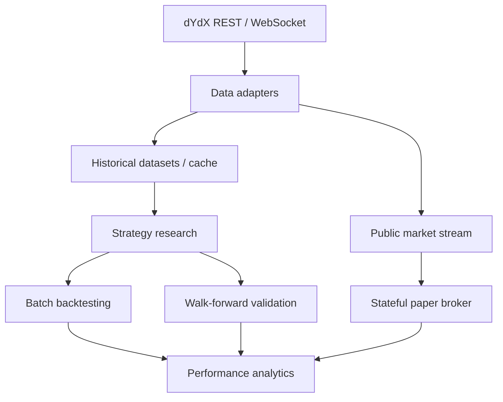

# Architecture

Open Strategy Lab is structured as a research-to-paper-trading framework. The
current repository intentionally stops before wallet handling, transaction
signing and live order placement.

## Layers

## Data layer

The REST adapter uses public Indexer endpoints for:

- perpetual markets
- candles
- historical funding

The historical loader pages explicit date ranges and aligns funding observations
backward so future observations are not assigned to earlier candles.

The WebSocket adapter currently supports public:

- `v4_candles`
- `v4_markets`

No private account channel is required.

## Strategy layer

Three reference strategies currently exercise different framework capabilities:

1. Funding-Aware Directional Strategy
2. Cross-Sectional Market-Neutral Momentum
3. Volatility-Regime Adaptive Strategy

The examples are reference implementations, not profitability claims.

## Validation layer

The framework includes:

- one-bar signal delay
- fees and slippage
- hourly funding accounting
- leverage and exposure limits
- walk-forward parameter selection
- out-of-sample evaluation
- future-data leakage regression tests
- paper-vs-batch accounting equivalence tests

## Paper-trading layer

`PaperBroker` is incremental. Each market observation updates:

- mark-to-market PnL
- confirmed funding input
- target exposure
- transaction costs
- position quantity
- account equity
- fill history

The broker can therefore be driven by replayed historical data or, in a later
milestone, a public streaming session.

## Funding semantics

The public market stream can expose `nextFundingRate`. It is forward-looking
market information and is not equivalent to a confirmed funding settlement.

Open Strategy Lab does not book `nextFundingRate` directly into paper PnL.
Confirmed settlement data must be supplied separately.

## Security boundary

The current codebase does not include:

- mnemonics
- private keys
- wallet creation
- transaction signing
- private subaccount access
- live order placement

Any future execution adapter should be isolated from the research package and
should consume signing material only through the user's runtime environment or a
dedicated secret store.
